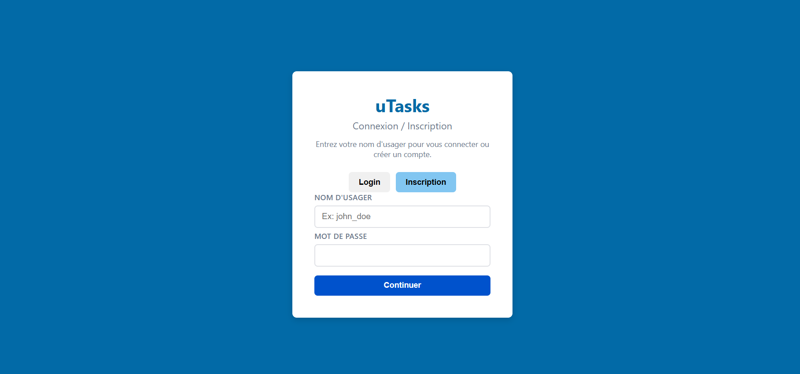
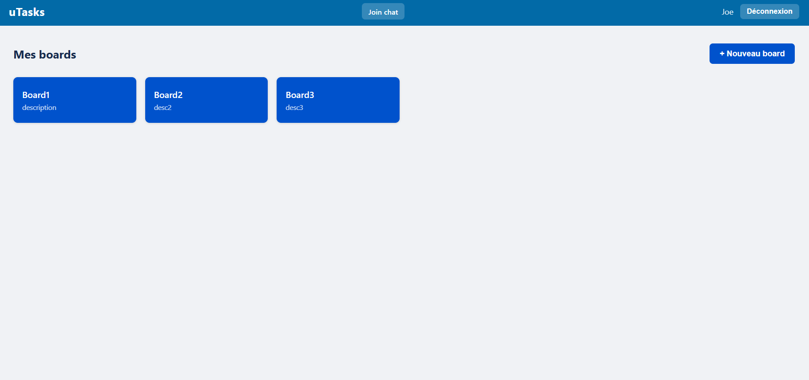
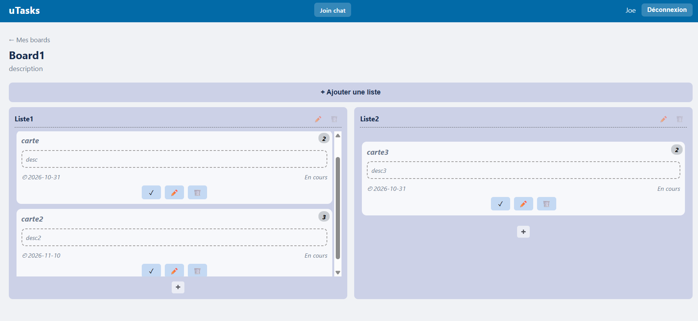
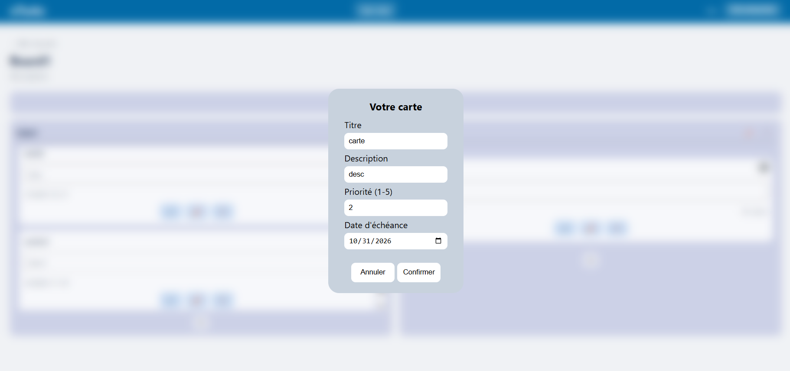
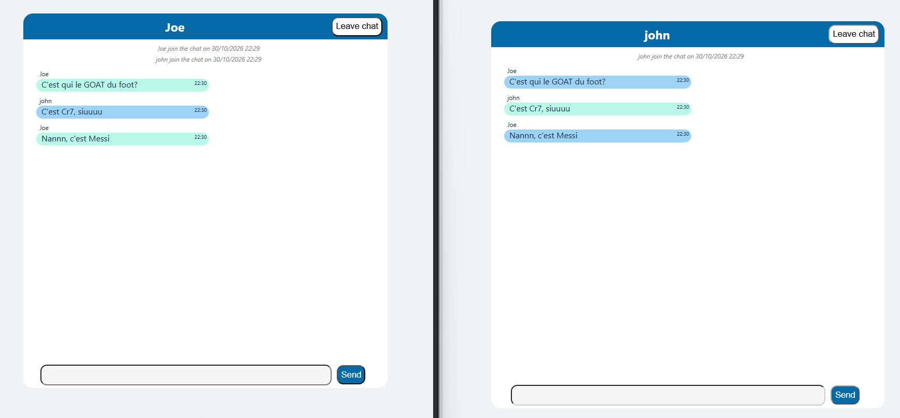

# UTasks ✅

Application **full-stack** de gestion de tâches inspirée de Trello : tableaux, listes et cartes déplaçables par glisser-déposer, avec un **chat en temps réel** entre utilisateurs.

## Technologies

| Couche | Outils |
|---|---|
| Frontend | Vue.js 3, Vue Router, Vite, API Drag and Drop HTML5 |
| Backend | Node.js, Express 5, API REST |
| Base de données | MongoDB, Mongoose |
| Temps réel | Socket.IO (serveur et client) |
| Sécurité / validation | JWT (jsonwebtoken), bcrypt, CORS, Joi |
| Tests / qualité | Vitest, Vue Test Utils, ESLint, Oxlint, Prettier |

## Fonctionnalités

- **Comptes** : inscription et connexion avec mot de passe haché et jeton JWT (valide 7 jours).
- **Tableaux** : créer, modifier, supprimer ses propres tableaux.
- **Listes et cartes** : CRUD complet, cartes avec description, priorité (basse / moyenne / haute), date d'échéance et statut terminé.
- **Glisser-déposer** des cartes d'une liste à l'autre.
- **Chat en temps réel** : messages diffusés instantanément, notifications d'arrivée et de départ des utilisateurs.
- **Contrôle d'accès** : les routes des tableaux et des cartes vérifient que la ressource appartient à l'utilisateur connecté.
- **Validation** des données envoyées à l'API (schémas Joi, identifiants MongoDB).

## Aperçu

### Connexion

### Boards

### Listes
| listes | modal de modification d'une carte|
|---|---|
|  |  |

### Chat temps réel

## API REST

| Ressource | Routes principales |
|---|---|
| Utilisateurs | `POST /api/users/register`, `POST /api/users/login`, `GET/DELETE /api/users/:id` |
| Tableaux 🔒 | `GET /api/boards/user/:userId`, `GET/PUT/DELETE /api/boards/:id`, `POST /api/boards` |
| Listes 🔒 | `GET /api/lists/board/:boardId`, `POST /api/lists`, `GET/PUT/DELETE /api/lists/:id` |
| Cartes 🔒 | `GET /api/cards/list/:listId`, `POST /api/cards`, `GET/PUT/DELETE /api/cards/:id` |

🔒 = protégé par le middleware JWT `protect`.

## Mes tâches

<!-- À ajuster : garde seulement ce que tu as réalisé toi-même -->
- Implémentation du drag and drop des cartes de la liste
- Interface des listes et cartes
- Mise en place du chat temps réel avec Socket.IO.

## Ce que j'ai appris

- Concevoir une application **full-stack** de bout en bout : base de données, API REST et interface.
- Sécuriser une API : **hachage des mots de passe**, **JWT**, middleware d'autorisation et vérification de propriété.
- Modéliser des données liées avec **Mongoose** (utilisateur → tableaux → listes → cartes).
- Utiliser les **WebSockets** pour de la communication en temps réel.
- Implémenter le **glisser-déposer** et synchroniser l'état de l'interface avec le serveur.
- Retourner des réponses d'API cohérentes (codes HTTP 400, 401, 403, 404, 409).

## Code source

Le code source est hébergé dans un dépôt privé (projet universitaire, Université Laval)
